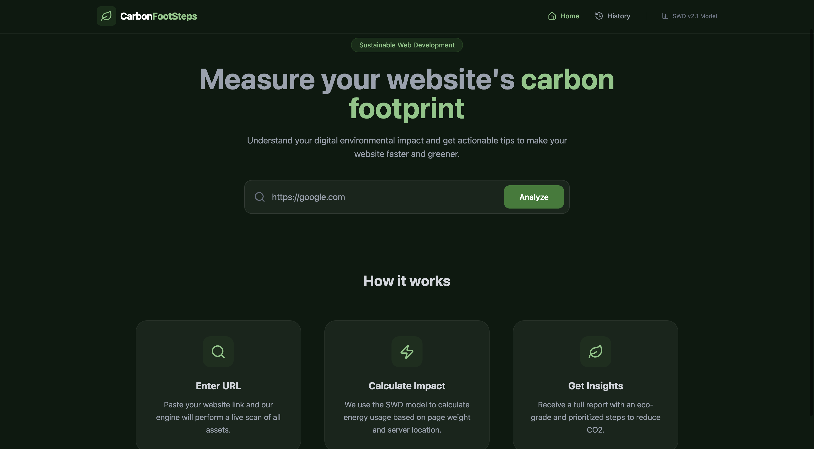
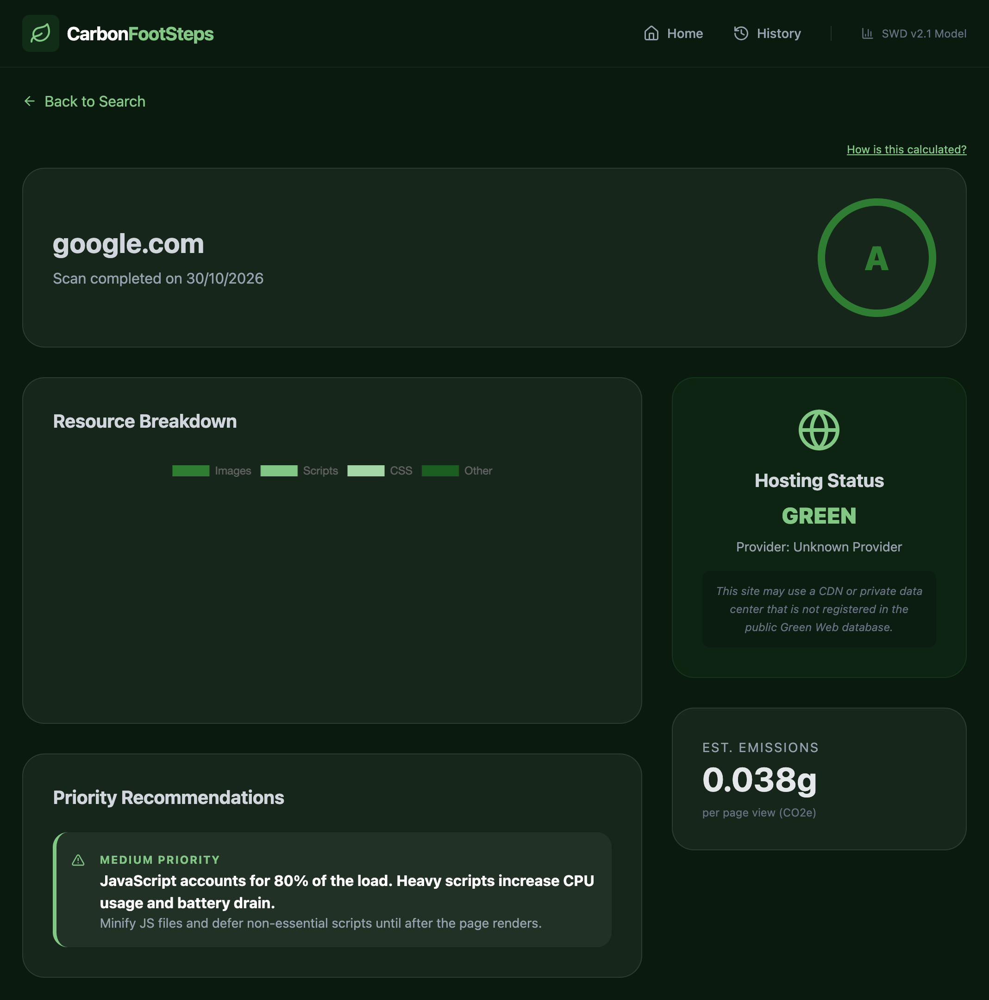

# Carbon FootSteps

A web app that estimates the carbon footprint of any website. Enter a URL and it loads the page in a headless browser, measures how much data it transfers, estimates the CO₂ emitted per page view, checks whether the host runs on renewable energy, and returns a grade with practical tips to reduce the page's impact.

**Live demo:** https://carbon-footprint-neon.vercel.app

> The backend runs on a free hosting tier that sleeps when idle, so the first audit after a quiet period can take a minute to wake up.

#### Home Page


#### Results Page


## Features

- **Real page measurement:** Puppeteer loads the page in headless Chrome and tallies transferred bytes by type (images, JavaScript, CSS, other).
- **Carbon estimate:** CO₂ and energy per page view using the Sustainable Web Design (SWD) model.
- **Green hosting check:** queries the [Green Web Foundation](https://www.thegreenwebfoundation.org/) API and adjusts the estimate when the host is verified green.
- **A–F grade** based on grams of CO₂ per view.
- **Recommendations:** rule-based tips (page weight, image share, script share, CSS size) ranked by priority.
- **Audit history:** every audit is saved to MongoDB and can be revisited.

## How it works

```
React (Vite) on Vercel ──► Express API on Render (Docker) ──► MongoDB Atlas
                                  │
                                  ├─ Puppeteer / headless Chrome (page scan)
                                  └─ Green Web Foundation API (hosting check)
```

1. The frontend sends the URL to `POST /api/audit`.
2. The URL is validated (http/https only, private and internal addresses blocked).
3. The scanner loads the page and records transferred bytes per resource type.
4. The calculator applies the SWD model:
   - energy = GB transferred × 0.81 kWh/GB
   - CO₂ = energy × carbon intensity, using 494 g/kWh globally or 50 g/kWh for verified green hosts
5. A grade is assigned from grams of CO₂ per view:

   | Grade | CO₂ per view |
   | ----- | ------------ |
   | A     | < 0.2 g      |
   | B     | < 0.5 g      |
   | C     | < 1.0 g      |
   | D     | < 2.0 g      |
   | F     | ≥ 2.0 g      |

6. Recommendation rules run on the scan data (page over 2 MB, images over 60% of bytes, JavaScript over 30%, CSS over 100 KB).
7. The audit is saved and returned to the frontend.

## Tech stack

| Layer      | Tools                                                       |
| ---------- | ----------------------------------------------------------- |
| Frontend   | React 19, Vite, React Router, Tailwind CSS, Chart.js, Axios |
| Backend    | Node.js, Express 5, Mongoose, Puppeteer                     |
| Database   | MongoDB Atlas                                               |
| Deployment | Vercel (frontend), Render with Docker (backend)             |

## API

| Method | Route            | Description                                          |
| ------ | ---------------- | ---------------------------------------------------- |
| `POST` | `/api/audit`     | Scan a URL. Body: `{ "url": "https://example.com" }` |
| `GET`  | `/api/audit/:id` | Fetch one saved audit                                |
| `GET`  | `/api/history`   | The 10 most recent audits                            |

## Running locally

**Requirements:** Node.js 20+, a MongoDB Atlas (or local MongoDB) connection string.

```bash
git clone https://github.com/iamzaidmohammed/CarbonFootprint.git
cd CarbonFootprint
```

**Backend**

```bash
cd backend
npm install
echo "MONGODB_URI=your_connection_string" > .env
npm run dev          # http://localhost:5000
```

**Frontend** (in a second terminal)

```bash
cd frontend
npm install
cp .env.example .env # VITE_API_URL=http://localhost:5000
npm run dev
```

### Environment variables

| Variable               | Where    | Purpose                                                    |
| ---------------------- | -------- | ---------------------------------------------------------- |
| `MONGODB_URI`          | Backend  | MongoDB connection string                                  |
| `PORT`                 | Backend  | Server port (default `5000`)                               |
| `CORS_ORIGIN`          | Backend  | Allowed frontend origin(s), comma-separated. Open if unset |
| `MAX_CONCURRENT_SCANS` | Backend  | Parallel scans allowed (default `1`)                       |
| `VITE_API_URL`         | Frontend | Backend base URL, without a trailing slash                 |

### Docker (backend)

```bash
cd backend
docker build -t carbon-backend .
docker run -p 5000:5000 --env-file .env carbon-backend
```

## Design decisions

- **Scan queue:** each scan launches a full Chrome instance, so scans run one at a time with a small waiting queue. Extra requests are rejected with a "server busy" message instead of exhausting memory.
- **URL validation:** because the server visits user-supplied URLs, it only allows http/https and blocks loopback, private and link-local addresses (including cloud metadata IPs).
- **Browser cleanup:** Chrome is always closed in a `finally` block, so failed scans don't leak processes.

## Limitations

- Transfer size is read from each response's `Content-Length` header, so responses without that header (for example chunked transfers) are not counted and totals may be underestimated.
- Some sites block automated browsers; those audits fail with an explanatory error.
- The estimate covers data transfer for a single page load, not device energy use or repeat visits with caching.
- The SWD constants are global averages, not measurements for a specific network or data center.

## Project background

Built as a university dissertation project at USTED (Department of Information Technology Education).
